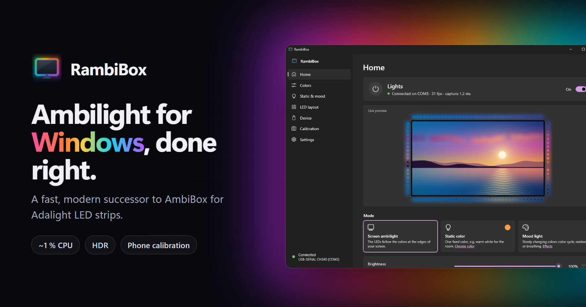
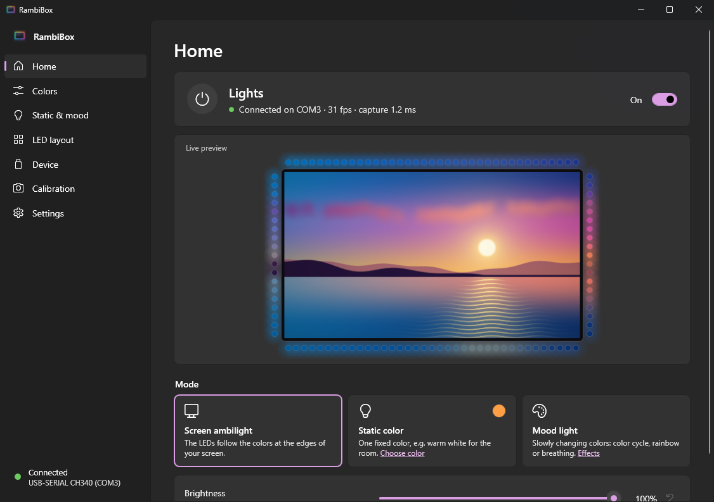
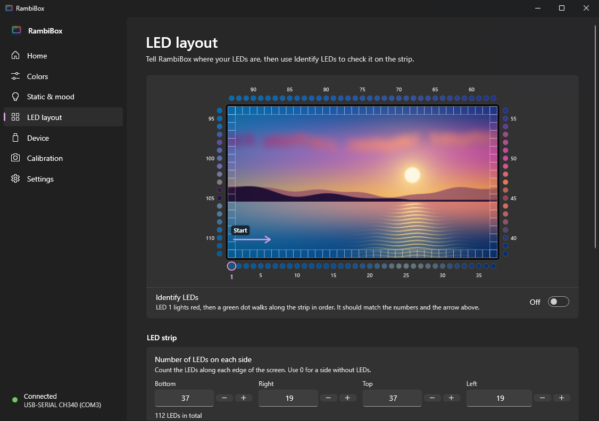
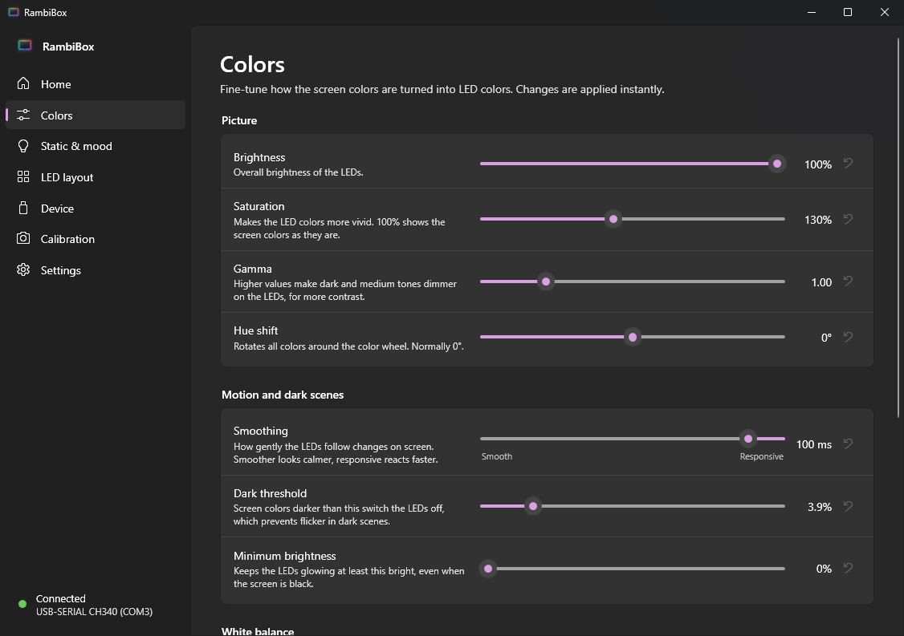
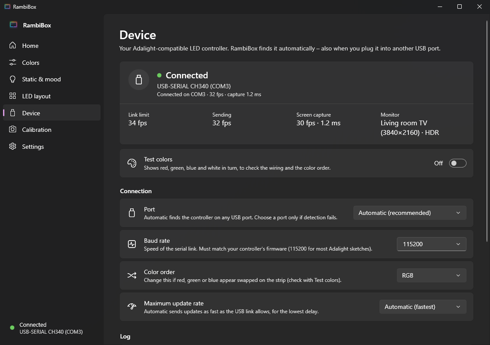
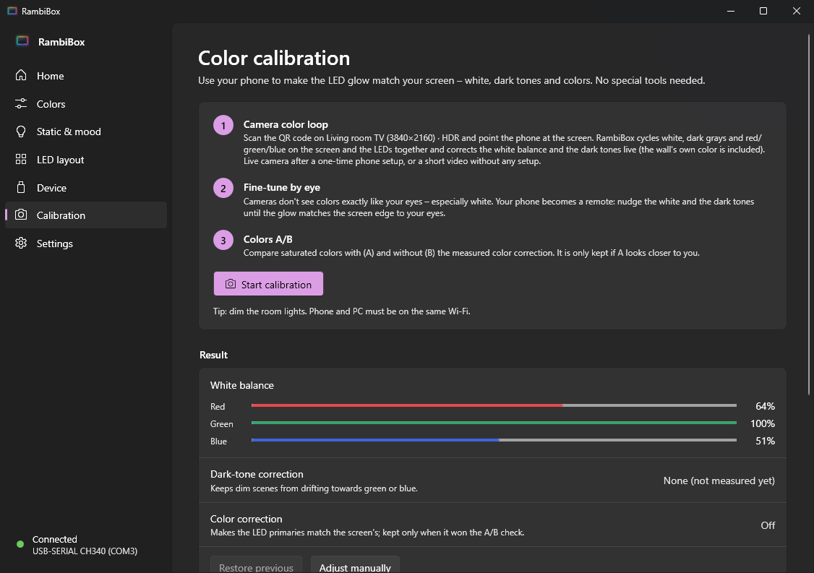
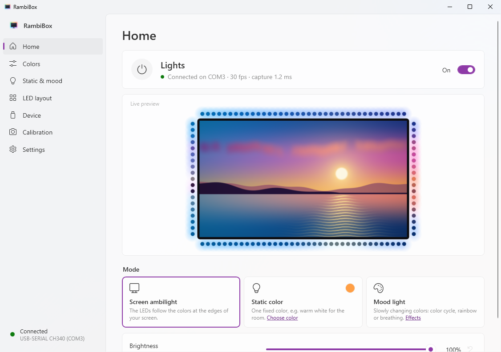

<p align="center">
  <a href="https://ferrywell.github.io/RambiBox/"></a>
</p>

<p align="center">
  <a href="https://github.com/Ferrywell/RambiBox/actions/workflows/ci.yml"></a>
  <a href="https://github.com/Ferrywell/RambiBox/releases/latest"></a>
  <a href="LICENSE"></a>
  
  
</p>

<p align="center">
  <a href="https://github.com/Ferrywell/RambiBox/releases/latest"><b>Download</b></a> ·
  <a href="https://ferrywell.github.io/RambiBox/"><b>Website</b></a> ·
  <a href="#phone-color-calibration">Calibration guide</a> ·
  <a href="#faq--troubleshooting">FAQ</a>
</p>

# RambiBox

**RambiBox turns an Adalight LED strip behind your monitor or TV into ambient light that follows the picture.** It
is a fast, modern replacement for the old AmbiBox on Windows 10 and 11:

- **Light on the system.** It uses about 1 % of one CPU core and ~22 MB of RAM when idle.
- **Fast.** It sends as many frames as the serial link can carry.
- **Easy to switch to.** It imports your AmbiBox settings and finds the LED controller by itself.
- **Accurate.** Your phone measures the colors, and your eyes have the final say.

One self-contained `.exe`, no installer, no .NET runtime, no admin rights.

## Screenshots

| Home with live preview | LED layout |
|---|---|
|  |  |
| **Colors** | **Device** |
|  |  |
| **Calibration** | **Light mode** |
|  |  |

Phone calibration screenshots are on the [website](https://ferrywell.github.io/RambiBox/#screenshots). All screenshots
were made with the built-in `--demo` mode, which shows a synthetic scene instead of the real desktop.

## Features

- **Screen ambilight.**
  - Captures the screen with DXGI desktop duplication and shrinks it on the GPU, at ~1.2 ms per frame.
  - Uses about 1 % of one CPU core while running.
  - With 112 LEDs at 115200 baud it reaches ~32 fps; at that point the serial link is the limit, not the PC.
  - Frames are paced by wire time, so nothing queues up. From capture to LED takes a few milliseconds plus the time
    on the wire.
- **HDR** desktops are tone-mapped, so the LEDs look like the SDR picture.
- **Black bars** from letterbox and pillarbox films are detected and skipped.
- **Static color** and **mood light**: color cycle, rainbow or breathing.
- **Automatic controller detection.**
  - Finds the controller ~65 ms after start.
  - Reconnects automatically when you plug the USB cable into another port, even with a new COM number.
  - Unknown serial devices are never probed again and again; Bluetooth and modem ports are never touched.
- **AmbiBox import.**
  - Brings over your LED layout, white balance, saturation, smoothing, static color and port.
  - Offers to close AmbiBox and remove it from startup. This is reversible.
- **[Phone color calibration](#phone-color-calibration).** It measures:
  - the white balance;
  - per-channel dark tones;
  - an LED color matrix.

  Then you fine-tune by eye, with your phone as a remote.
- **Power-aware.** The LEDs go off when the display turns off, or the PC sleeps or shuts down. Optionally also when
  the PC is locked.
- **A native Windows 11 look.**
  - WPF Fluent design that follows your light/dark mode and accent color, with per-monitor DPI.
  - Lives in the tray: left-click opens the window; right-click gives on/off, mode, brightness and exit.
- **Lightweight.**
  - One ~90 MB self-contained exe.
  - The window is fully released when closed, so idling in the tray takes ~22 MB of RAM.

## Download & install

### Option 1: download the exe (recommended)

1. Download **`RambiBox.exe`** from the [latest release](https://github.com/Ferrywell/RambiBox/releases/latest).
   Optionally check it against the attached `RambiBox.exe.sha256`.
2. Put it in a folder of your choice, e.g. `%LocalAppData%\Programs\RambiBox`, and start it.
3. **SmartScreen:** the exe is not code-signed, so Windows may show *"Windows protected your PC"*. Click
   **More info → Run anyway**.

### Option 2: build and install from source

With the [.NET 10 SDK](https://dotnet.microsoft.com/download/dotnet/10.0) installed:

```bat
git clone https://github.com/Ferrywell/RambiBox
cd RambiBox
install.cmd
```

`install.cmd` needs no admin rights. It:

- builds `dist\RambiBox.exe` (via `publish.cmd`);
- copies it to `%LocalAppData%\Programs\RambiBox`;
- adds a Start menu shortcut and starts it.

### Uninstall

1. Turn off *Start with Windows* in Settings.
2. Choose **Exit** in the tray menu.
3. Delete the exe.
4. To remove all traces, also delete:
   - `%AppData%\RambiBox` (settings, phone certificate);
   - `%LocalAppData%\RambiBox` (logs).

## First run

1. **AmbiBox import.**
   - On the first start, RambiBox imports your AmbiBox settings automatically: LED layout, white balance,
     saturation, smoothing, static color and port.
   - If AmbiBox is installed but not used, you can re-import later in Settings.
2. **Hand-over from AmbiBox.**
   - If AmbiBox is still running or starts with Windows, RambiBox offers to close it and remove it from startup.
     Only one program can use the LED controller.
   - This is reversible: the shortcut is kept as `%AppData%\RambiBox\AmbiBox.lnk.disabled`.
3. **Controller auto-detect.** RambiBox finds the controller by itself. The status is shown on the Home and
   Device pages.
4. **Check the layout.**
   - On **LED layout**, set the number of LEDs per side and the start corner, then turn on **Identify LEDs**.
   - LED 1 lights red and a green dot walks along the strip.
5. **Start with Windows.** Turn it on in **Settings**. RambiBox then starts quietly in the tray.

## Phone color calibration

LED strips are rarely neutral: white turns bluish, dark scenes drift green, and the wall adds its own tint.
RambiBox measures this with your phone's camera. No colorimeter and no app are needed.

1. Open **Calibration → Start calibration**. A QR code appears on the captured screen.
2. Scan it with your phone. Phone and PC must be on the **same Wi-Fi**.
   - If Windows asks about the firewall, allow **Private networks**.
   - Or use **Allow…** on the Calibration page beforehand (admin needed).
3. Point the phone at the screen so it sees the screen and the glow on the wall.
   - Screen and LEDs run a **color loop** together: room light → white → dark grays → white → red/green/blue. Every
     frame is tagged with a visual step code.
   - RambiBox corrects the **white balance** and per-channel **dark tones** live, including the wall's own tint.
   - It also measures an **LED color matrix**.
4. **Fine-tune by eye.** Cameras don't see narrow-band LEDs the way your eyes do. The phone becomes a remote:
   nudge white and dark tones until the glow matches the screen edge.
5. **Colors A/B.** Compare saturated colors with (A) and without (B) the measured color correction. It is only kept
   if A looks closer to you.

### Live camera: the one-time certificate step

Browsers only allow the live camera on HTTPS pages. RambiBox creates its own local root certificate for this:

- It is **name-constrained**: it only works for private IP addresses and `.local` names.
- Its key is **DPAPI-protected** in `%AppData%\RambiBox\phone-ca`.

The phone page walks you through installing it once.

- **iPhone / iPad**
  1. Open the setup link in **Safari** and tap **Allow** to download the profile. Other browsers save it to
     **Files → Downloads**; tap it there.
  2. Install it: **Settings → General → VPN & Device Management →** the RambiBox profile **→ Install**.
  3. **Important:** go to **Settings → General → About → Certificate Trust Settings** and turn on
     **RambiBox Local CA**. Installing alone is not enough.
- **Android:** install the downloaded certificate as a **CA certificate** when the page asks (Settings → Security →
  Encryption & credentials → Install a certificate).
- **No setup?** The phone records a ~25 s video instead and uploads it. This works without any certificate.

You can revoke the certificate at any time:

- on the phone, by removing the profile or certificate;
- on the PC, with **Calibration → Reset phone certificate**.

See [SECURITY.md](SECURITY.md) for how the calibration server is protected.

## Supported hardware

| | |
|---|---|
| **Controller** | Arduino Nano, Uno, Pro Micro, Leonardo and clones running an **Adalight-compatible sketch** that sends the `Ada` greeting on start, e.g. the FastLED Adalight/"LEDstream" sketch used with AmbiBox. |
| **USB-serial chips** | CH340/CH341/CH9102, FTDI FT232R/FT-X, Silicon Labs CP210x and Arduino's own USB (VID 2341/2A03) are recognized for auto-detect. Other chips work with a fixed port. |
| **Link** | **115200 baud** by default; other rates can be chosen on the Device page. RGB, GRB and other color orders are supported. |
| **LEDs** | WS2812B, WS2811, SK6812 and anything else your sketch drives. Any count and start corner, clockwise or counter-clockwise. |
| **PC** | Windows 10 version 2004 (build 19041) or newer, or Windows 11, 64-bit. Any GPU with DXGI desktop duplication. HDR supported. If you have several monitors, choose the one behind the strip. |

## FAQ & troubleshooting

<details>
<summary><b>"Port busy": the COM port is in use (by AmbiBox)</b></summary>

Only one program can open the LED controller. If AmbiBox (or Prismatik, the Arduino IDE's serial monitor, …) is
running, RambiBox shows a warning and offers to **close AmbiBox** and **remove it from startup**. Otherwise close that
program yourself. RambiBox reconnects automatically as soon as the port is free.
</details>

<details>
<summary><b>Windows Firewall asks about RambiBox</b></summary>

Only the phone calibration needs the network. Allow **Private networks** only. The server only answers devices on
your local network, needs the token from the QR code, and stops after the calibration (at most 45 minutes).
If you cancelled the prompt, use **Calibration → Allow…**.
</details>

<details>
<summary><b>Brave or Safari: certificate warnings, noisy colors, the profile won't install</b></summary>

- **Brave:**
  - If Brave shows a certificate warning, tap **Show details → Visit this website**.
  - Brave Shields add random noise to camera images ("farbling"). Turn Shields **off** for the calibration page
    (lion icon) for accurate results.
- **iPhone:** only **Safari** can install the certificate profile directly. In other browsers, open the downloaded
  file from the **Files** app. Don't forget **Certificate Trust Settings** (see above).
</details>

<details>
<summary><b>HDR: colors look washed out or too bright</b></summary>

RambiBox captures HDR desktops in their native 16-bit format and tone-maps them to SDR, using Windows' *SDR content
brightness* as the white level. So the LEDs look like the SDR picture. If they still look too bright or dull,
fine-tune Brightness, Saturation and Gamma on the Colors page.
</details>

<details>
<summary><b>Colors are swapped or tinted</b></summary>

Turn on **Device → Test colors**: red, green, blue and white are shown in turn. If they are swapped, change the
**Color order**. For tinted whites, run the phone calibration or adjust the white balance on the Colors page.
</details>

<details>
<summary><b>The LEDs don't line up with the screen</b></summary>

On **LED layout**:

1. Set the LEDs per side and the start corner and direction.
2. Use **Identify LEDs**: LED 1 lights red, then a green dot walks along the strip.
3. If the strip starts with LEDs that are not behind the screen, set **LEDs to skip** there too.
</details>

<details>
<summary><b>Where are the settings and the log?</b></summary>

| What | Where |
|---|---|
| Settings | `%AppData%\RambiBox\settings.json` (+ `.bak`) |
| Log | `%LocalAppData%\RambiBox\logs\rambibox.log` |
| Phone certificate | `%AppData%\RambiBox\phone-ca` |
</details>

## Command line

| Switch | |
|---|---|
| `--tray` | Start hidden in the notification area (used by *Start with Windows*). |
| `--exit` | Ask a running instance to exit cleanly (LEDs off), e.g. before an update. |
| `--simulate` | Use a simulated LED controller (for development; separate settings file). |
| `--demo` | Simulated controller **and** a synthetic animated scene instead of the real desktop, with fresh default settings. Made for screenshots. |
| `--page=<name>`, `--theme=<light\|dark>` | Open on a page (`home`, `colors`, `static`, `layout`, `device`, `calibration`, `settings`) and force a theme. |

## Building from source

Requires Windows and the **.NET 10 SDK**.

```bat
dotnet build RambiBox.slnx
dotnet test tests/RambiBox.Tests --filter "Category!=Hardware"
dotnet test tests/RambiBox.Tests --filter "Category=Hardware"   &rem needs the LED controller + monitor; close RambiBox first
dotnet run --project src/RambiBox.App -- --demo                  &rem try the UI without hardware
publish.cmd                                                      &rem single self-contained dist\RambiBox.exe
```

## Project structure

```
src/RambiBox.Core      engine, capture, Adalight device, calibration, settings (no UI)
  Capture/             DXGI desktop duplication, GPU downscale, HDR tone-mapping, black-bar detection
  Devices/             Adalight protocol, serial link, port enumeration, auto-detect / re-plug handling
  Engine/              LightEngine frame loop, smoothing, color processing, test patterns
  Calibration/         phone calibration: LAN HTTP(S) server, local CA, color-loop analysis
  Config/              settings model and JSON, AmbiBox importer, LED layout generator
src/RambiBox.App       WPF tray app (Fluent): views, view models, tray icon, Windows integration
  Dev/                 SimulatedLedDevice (--simulate) and DemoScreenSampler (--demo)
tests/RambiBox.Tests   ~220 xUnit tests (hardware tests are tagged Category=Hardware)
docs/                  website (GitHub Pages)
tools/                 icon generator
```

## Contributing

Contributions are welcome. Read [CONTRIBUTING.md](CONTRIBUTING.md) for the setup, the test categories and the
guidelines, and the [Code of Conduct](CODE_OF_CONDUCT.md). Please report security issues privately as described in
[SECURITY.md](SECURITY.md).

## License

Copyright © 2026 Ferry.

RambiBox is free software: you can redistribute it and/or modify it under the terms of the
**GNU General Public License** as published by the Free Software Foundation, either **version 3** of the License, or
(at your option) any later version. See [LICENSE](LICENSE).

RambiBox is an independent project. It is not affiliated with or endorsed by AmbiBox or Adafruit. "Adalight" refers
to the open LED protocol.
